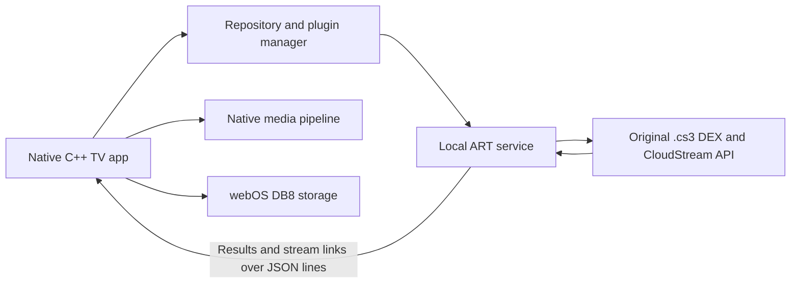

# CSWeb TV

A native LG webOS TV app that runs unmodified CloudStream `.cs3` extensions **on the TV**.

CSWeb TV combines a C++ television interface with a bundled Android Runtime (ART). Extensions supply
providers, search results, metadata and playable links; the native app handles navigation, storage and
playback. No companion computer or remote execution server is required.

The app ships **no content, extensions or extension repositories**. Add repositories yourself in
**Settings → Extensions**. This is a community project, independent of LG and CloudStream.

[Downloads](https://github.com/sostk/cloudstream-webos-native/releases) ·
[CI builds](https://github.com/sostk/cloudstream-webos-native/actions/workflows/ci.yml) ·
[Device compatibility and reporting](docs/compatibility.md)

## Project status

CSWeb TV is under active development. The reference device is an **LG OLED65C1PTB, webOS 6.5.3,
firmware 03.53.45**. Recorded on-device results include execution of original plugins and real provider
operations; these establish support for the tested cases, not every extension or LG television.
See the [runtime feasibility decision](docs/FEASIBILITY_DECISION.md) and
[project status and evidence](docs/STATUS.md).

An experimental legacy package targets older TVs, including models with a 32-bit kernel.
Compatibility depends on the kernel, firmware libraries, extension APIs and media codecs.
Please [report both successful and unsuccessful device tests](docs/compatibility.md).

## Features

- Remote-control interface with Home, Search, Library and Settings.
- Extension repository management, plugin installation, updates, removal and supported settings dialogs.
- Provider home pages, search, details, episodes and stream-link extraction.
- Native playback with source selection, subtitles, audio tracks, resume and next-episode support.
- Local profiles, bookmarks, watch history and preferences.

Not every CloudStream feature is available. Known limits include extensions requiring WebView or
Android-specific screens, torrent/magnet playback, Widevine/PlayReady, video downloads, and online
account synchronization. A provider may load successfully while search, extraction or playback fails.
See [app behavior and differences](apps/csweb-tv/README.md#behaviour-and-cloudstream).

## How it works



The [webOS Native App Kit](https://github.com/Native-Webos/webos-native-app-kit) supplies the
SDL/OpenGL ES interface, remote input, networking, persistence, diagnostics and media integration.
This repo fetches it at the commit pinned in [tools/fetch-kit.sh](tools/fetch-kit.sh).

The app launches a separate, long-lived ART process through the runtime's own musl loader.
CloudStream's API classes and this project's Android compatibility layer let supported extensions
execute their original DEX. Requests and results use a
[JSON-lines service protocol](docs/runtime/service-protocol.md), with
[plugin dialogs](docs/runtime/dialog-protocol.md) translated into native UI.

The native app executable uses the webOS ARM userland ABI. Its private plugin runtime has its own
architecture and C library; it runs in a separate process and is not loaded into the UI process.
That is why an IPK filename ending in `_arm.ipk` can still require a 64-bit kernel.

Settings, profiles, library data, repositories and installed plugins use DB8. Runtime working files
live under `/tmp/<app-id>/`. Supported plugin data is snapshotted to DB8; caches and temporary logs
are not permanent storage. See the [app layout](apps/csweb-tv/README.md).

## Choose a package

| Package | App ID | Plugin runtime | Intended use |
| --- | --- | --- | --- |
| Main | `org.csweb.tv` | AArch64 ART | TVs with a 64-bit kernel and firmware providing `libcurl.so.4` |
| Legacy (experimental) | `org.csweb.tv.legacy` | ARMv7 ART, bundled curl/mbedTLS | Older TVs with a 32-bit kernel or missing main-package HTTP transport |

A kernel reporting `armv7l` cannot execute the main package's AArch64 runtime. webOS version and
the panel's resolution alone do not identify the kernel architecture. The main package expects
firmware libcurl normally available on webOS 5.3.1 and later; firmware variation still matters.

The packages use different app IDs and can coexist, with separate settings and logs.
Legacy support is opt-in and does not change the main build. See
[legacy build requirements and troubleshooting](docs/legacy-build.md).
Legacy runtime fixes under review are tracked separately in
[PR #11](https://github.com/sostk/cloudstream-webos-native/pull/11); an older build from `main`
may not contain them. A passing ARM CI test is not a successful test on your TV.

## Install and get started

1. Download an app IPK from [Releases](https://github.com/sostk/cloudstream-webos-native/releases),
   or open a [CI run](https://github.com/sostk/cloudstream-webos-native/actions/workflows/ci.yml)
   for the branch you want to test. CI artifacts are ZIP archives: extract the IPK before installation.
   The artifact names are `org.csweb.tv-ipk` and, when built, `org.csweb.tv.legacy-ipk`.
2. Install through [webOS Dev Manager](https://github.com/webosbrew/dev-manager-desktop) with Developer
   Mode enabled, or use `ares-install` on a configured TV. Developer Mode installation does not need root.
3. Launch **CSWeb TV** or **CSWeb TV Legacy**, finish setup and add your repository URL under
   **Settings → Extensions**.
4. Install an extension, select a provider, then try its home page or a search.

CI artifacts expire and require GitHub access. A green overall run does not guarantee a legacy
artifact exists: legacy jobs are allowed to fail. Runtime-input mirror releases contain build
dependencies, not an installable TV app. Legacy release publication also requires its licence notices;
see [release.yml](.github/workflows/release.yml).

## Dependencies

| Component | Role |
| --- | --- |
| Native App Kit, SDL2, OpenGL ES | Native app shell, rendering, input and platform integration |
| FFmpeg and the kit's webOS media backends | Demuxing and native audio/video playback |
| Alpine `art_standalone`, musl and ICU | Self-contained runtime for plugin DEX |
| CloudStream API, Kotlin and JVM libraries | Provider API and extension dependencies |
| Android compatibility layer in `runtime/android-compat/` | Supported Android APIs, resources and preferences |
| wolfSSL / wolfSSL JNI, CA trust store | Runtime HTTPS |
| Firmware libcurl (main), bundled curl + mbedTLS (legacy) | Native app HTTP/HTTPS |
| webOS DB8 | Persistent app and plugin storage |

Main runtime inputs and checksums are in [runtime/inputs.lock](runtime/inputs.lock);
[runtime/build.sh](runtime/build.sh) pins the Java build dependencies.
[Runtime inputs](docs/runtime/inputs.md), [TLS notes](docs/runtime/tls.md) and
[licence notices](runtime/licenses/NOTICES.md) describe versions, sources and special build requirements.
The scripts fetch dependencies; you do not need a system Android SDK for the documented build.
Build containers and every compiler are not fully pinned, so pinned inputs alone do not promise
byte-for-byte reproducible packages.

## Build locally

The documented path is **Linux**, matching CI's Ubuntu 24.04 environment. A host UI/test build and a
TV package build are separate tasks. Run the following from a fresh clone:

```sh
git clone https://github.com/sostk/cloudstream-webos-native.git
cd cloudstream-webos-native
export CSWEB_SRC="$PWD"
tools/fetch-kit.sh
```

Keep the kit at its pinned commit. App sources stay in this repository and are added through
`WNK_EXTRA_APP_DIRS`; editing the kit is not required.

### 1. Install build tools

On Ubuntu 24.04, the host dependencies used by CI are:

```sh
sudo apt-get update
sudo apt-get install -y --no-install-recommends \
  cmake g++ make pkg-config python3 git curl xz-utils binutils \
  libsdl2-dev libgles-dev libegl-dev libegl-mesa0 libgl1-mesa-dri \
  libcurl4 openssl ffmpeg
```

TV runtime assembly also needs a working **Docker daemon** and permission to run Docker.
Its containers install the Java, D8, native and Alpine tools they need. Allow time, disk space and
network access for the first runtime and FFmpeg builds.

### 2. Build and test the host app

```sh
cd "$CSWEB_SRC/external/webos-native-app-kit"
cmake --preset host-debug \
  -DWNK_EXTRA_APP_DIRS="$CSWEB_SRC/apps/runtime-probe;$CSWEB_SRC/apps/csweb-tv"
cmake --build --preset host-debug -j"$(nproc)"
ctest --preset host-debug -j"$(nproc)"

cd "$CSWEB_SRC"
python3 -m unittest discover -s tests -v
```

The desktop binary is
`external/webos-native-app-kit/build/host-debug/extra-apps/csweb-tv/csweb-tv`.
Use arrows, Enter and Escape for navigation. A working GL display is needed for graphical tests;
headless CI uses Mesa. See [CI](.github/workflows/ci.yml) for the separate ASan configuration.

**Host tests do not install a host plugin runtime.** The app looks for
`runtime/dist/runtime-$(uname -m)`; building the main TV runtime below produces AArch64 files,
which an x86_64 desktop cannot execute directly. UI/unit tests can run without working providers.
Manual host runtime assembly is documented in [the runtime test plan](docs/research/runtime-test-plan.md)
and the scripts under `runtime/`.

### 3. Build the main TV runtime

```sh
cd "$CSWEB_SRC"
tools/build-runtime.sh
```

This fetches verified inputs, builds the compatibility DEX and native helpers, assembles
`runtime/dist/runtime-aarch64`, attempts the configured ahead-of-time compilation, and checks
licence notices. Input downloads are cached under `~/.cache/csweb-runtime-inputs`.
Use the default pinned build for testing; `--latest` intentionally uses changing upstream inputs.

If you already have a `runtime-aarch64` artifact from the **same source revision**, you can extract
its outer ZIP, then unpack `runtime-aarch64.tar` into `runtime/dist/` instead. Check that
`runtime/dist/runtime-aarch64/lib/ld-musl-aarch64.so.1` exists before packaging.

### 4. Install the webOS NDK

CI uses the `webos-d7ed7ee` SDK from
[openlgtv/buildroot-nc4](https://github.com/openlgtv/buildroot-nc4/releases/tag/webos-d7ed7ee)
(ARM webOS GCC 12.2.0). To install the same SDK:

```sh
mkdir -p "$HOME/webos-ndk"
curl -fL --retry 3 -o /tmp/csweb-webos-ndk.tar.gz \
  https://github.com/openlgtv/buildroot-nc4/releases/download/webos-d7ed7ee/arm-webos-linux-gnueabi_sdk-buildroot.tar.gz
echo "32816626e99fb34922a49d0c639f7c8a30356fffb222372d4823027f1382f640  /tmp/csweb-webos-ndk.tar.gz" | sha256sum -c -
tar -xzf /tmp/csweb-webos-ndk.tar.gz -C "$HOME/webos-ndk"
export WEBOS_NDK="$HOME/webos-ndk/arm-webos-linux-gnueabi_sdk-buildroot"
(cd "$WEBOS_NDK" && ./relocate-sdk.sh)
```

Keep `WEBOS_NDK` set in the shell where you configure the TV build. The authoritative CI setup
is [.github/actions/webos-ndk/action.yml](.github/actions/webos-ndk/action.yml).

### 5. Build and check the main IPK

```sh
cd "$CSWEB_SRC/external/webos-native-app-kit"
cmake --preset webos-release \
  -DWNK_EXTRA_APP_DIRS="$CSWEB_SRC/apps/runtime-probe;$CSWEB_SRC/apps/csweb-tv"
cmake --build --preset webos-release -j"$(nproc)" --target csweb-tv-ipk
```

The package target runs the kit's package checks and writes
`build/webos-release/dist/org.csweb.tv_<version>_arm.ipk`.
Do not ignore the CMake warning about a missing runtime: such a package cannot load extensions.

After configuring your TV with [ares-cli-rs](https://github.com/webosbrew/ares-cli-rs) and
`ares-setup-device`, install the generated IPK. For the current default version:

```sh
export ARES_DEVICE=your-configured-device-name
tools/install.sh build/webos-release/dist/org.csweb.tv_0.1.0_arm.ipk \
  --private-runtime runtime-aarch64
tools/launch.sh org.csweb.tv
```

Use your generated filename if the version differs.

### Legacy build

Legacy is a separate build directory and app ID:

```sh
cd "$CSWEB_SRC"
tools/build-runtime.sh --arch armv7

cd "$CSWEB_SRC/external/webos-native-app-kit"
cmake --preset webos-release -B build/webos-legacy \
  -DWNK_EXTRA_APP_DIRS="$CSWEB_SRC/apps/csweb-tv" -DCSWEB_LEGACY=ON
cmake --build build/webos-legacy -j"$(nproc)" --target csweb-tv-ipk
```

Output: `build/webos-legacy/dist/org.csweb.tv.legacy_<version>_arm.ipk`.
When using the kit installer, pass `--private-runtime runtime-armv7`.

Unpinned ARMv7 assembly may rebuild ART. A native ARM host with 32-bit userspace support is preferred;
on x86_64, foreign ARM containers require qemu/binfmt setup and an ART compile can take hours.
You can reuse CI's signed `art-armv7` APK artifact with `CSWEB_ARMV7_ART_DIR` instead.
Read [the legacy guide](docs/legacy-build.md) before starting; it covers the exact command, caching,
input pinning, licence gates and CA installation path.

## Troubleshooting and compatibility reports

Logs are under `/tmp/org.csweb.tv/` for main and `/tmp/org.csweb.tv.legacy/` for legacy:

- `events.log`: device information, app lifecycle, HTTP transport and runtime launch status.
- `runtime.log`: ART and extension diagnostics, when the runtime launches.
- `crash.log` and `stalls.log`: additional diagnostics when generated.

Collect logs before rebooting because `/tmp` is temporary. Runtime-log access differs between old
builds; see the [compatibility guide](docs/compatibility.md) if Dev Manager cannot read it.

| Symptom | What to check |
| --- | --- |
| `runtime: exited (code 127)` | Kernel architecture and matching runtime; a 32-bit kernel cannot start AArch64 |
| `no HTTP transport` / missing `libcurl.so.4` | Firmware transport availability, package variant and build revision |
| Extension installs but never loads | `runtime.log`, exact plugin version and whether runtime fixes are included |
| Provider loads but video fails | Link extraction, codec/container, DRM, stream headers and network access |

Use the [device report template](docs/compatibility.md) for successes, partial support and failures.
Report reproducible bugs in [Issues](https://github.com/sostk/cloudstream-webos-native/issues).
Only install extensions you trust: they execute code in the runtime, and a matching hash does not
establish publisher trust.

## Repository map and further reading

| Path | Purpose |
| --- | --- |
| `apps/csweb-tv/` | Native app, player, plugin manager and C++ tests |
| `apps/runtime-probe/` | Runtime feasibility and diagnostic app |
| `runtime/` | ART assembly, compatibility layer, loader, trust stores and notices |
| `tools/` | Input fetching, runtime builds and analysis tools |
| `tests/`, `test-plugins/` | Project tooling tests and owned plugin fixtures |
| `docs/` | Runtime protocols, platform research, build guides and evidence summaries |
| `evidence/` | Recorded host/device results and input provenance |

Start with [app internals](apps/csweb-tv/README.md),
[runtime input pins](docs/runtime/inputs.md),
[AOT and stable paths](docs/runtime/aot.md), and
[plugin compatibility research](docs/research/plugin-compatibility.md).

## Licence and acknowledgements

Project code is **GPL-3.0-or-later**, as identified in its source headers. The Native App Kit,
CloudStream API and runtime components retain their own licences and notices.
Packages carry app/kit notices under `licenses/` and runtime notices under
`runtime-aarch64/licenses/` or `runtime-armv7/licenses/`; legacy curl notices are separate.
See [runtime notices](runtime/licenses/NOTICES.md) and the
[kit's licensing documentation](https://github.com/Native-Webos/webos-native-app-kit/blob/5b07b2df724e414b9efed9c46ed18df6e4f647b3/LICENSING.md).
Redistributors must preserve notices and meet the source obligations of the components they ship.

Built on the work of [Native-Webos](https://github.com/Native-Webos/webos-native-app-kit),
[CloudStream](https://github.com/recloudstream/cloudstream),
[Alpine Linux](https://alpinelinux.org/) and the webOS homebrew community.
